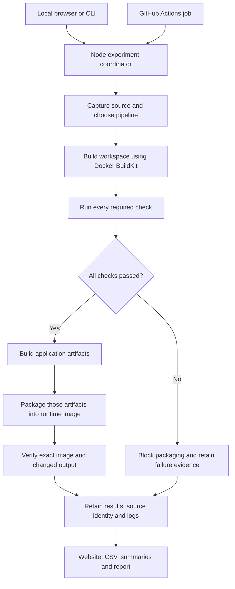
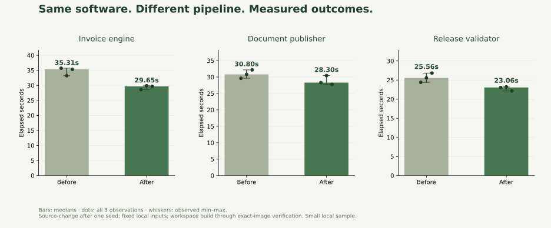
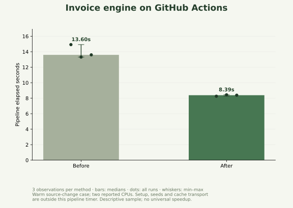

# Reducing CI Pipeline Build Time Using Dependency Caching, Parallel Stages and Docker BuildKit

**Detailed implementation, experiment, operation and demonstration report**  
**Assessment:** DevOps Lab CA mini project  
**Team:** Parth Dhande and Pushkar Rai, Batch 3  
**Report date:** 21 October 2026, India Standard Time  
**CI platform:** GitHub Actions  
**Implementation reviewed:** repository source at `dd44bd1a10775e3284b7b7e29ab4624ea07531a5`, plus the retained experiments identified below.

This report separates implemented features, observed measurements, interpretations and proposed extensions. A percentage is an experimental observation, not an advertised guarantee. The accompanying [report-data.json](v2/report-data.json) contains the run identifiers, exact numeric observations, stage intervals, source identities and verification results used here. No new performance experiment was run merely to write this report.

## Contents

1. [Project in plain language](#1-project-in-plain-language)
2. [Assessment, scope and problem](#2-assessment-scope-and-problem)
3. [Architecture and repository](#3-architecture-and-repository)
4. [How the pipeline gets faster](#4-how-the-pipeline-gets-faster)
5. [The three applications](#5-the-three-applications)
6. [What changes between builds](#6-what-changes-between-builds)
7. [Experiment design and timing](#7-experiment-design-and-timing)
8. [Results and their interpretation](#8-results-and-their-interpretation)
9. [Correctness and negative controls](#9-correctness-and-negative-controls)
10. [Every website control](#10-every-website-control)
11. [GitHub Actions](#11-github-actions)
12. [Installation and daily operation](#12-installation-and-daily-operation)
13. [Configuration, combinations and changes](#13-configuration-combinations-and-changes)
14. [Implementation details and evidence](#14-implementation-details-and-evidence)
15. [Demonstration and faculty questioning](#15-demonstration-and-faculty-questioning)
16. [Limitations and honest claims](#16-limitations-and-honest-claims)
17. [Custom applications and future work](#17-custom-applications-and-future-work)
18. [Evidence register and references](#18-evidence-register-and-references)

## 1. Project in plain language

When a developer changes application code, the team needs to check that the change works and produce a runnable package. A CI pipeline automates those steps. Developers wait for its answer before trusting or integrating a change.

We investigate two avoidable sources of waiting:

- Preparing the same libraries again even though only application code changed.
- Running independent checks one after another when they could run together.

We built three small applications, an experiment coordinator, Docker build configurations, GitHub Actions automation, a browser control panel and an evidence/reporting system. The system runs real commands, captures elapsed times and checks the resulting application package. The website starts experiments and displays their evidence; it does not generate simulated progress or invented numbers.

The work being optimized is **the checking and packaging process**. We do not claim to make invoice calculations, document compression algorithms or the running application itself faster.

### 1.1 Essential vocabulary

| Term | Meaning in this project |
| --- | --- |
| Source code | The files developers edit. |
| Dependency | A library or tool the application needs. |
| CI | Continuous integration: automated feedback on changes. Here GitHub Actions provides the CI execution platform. |
| Pipeline | The ordered steps that prepare, check, build, package and verify software. |
| Build | Depending on context, either creating application artifacts or the entire measured pipeline. Tables in this report use the full measured pipeline boundary. |
| Cache | Saved work that may be reused if its inputs remain valid. |
| Docker image | A packaged filesystem and runtime configuration that can be started as a container. |
| Container | An isolated running process environment created from an image. |
| BuildKit | Docker's build engine, used here for layers, mounts, named contexts and cache import/export. |
| Buildx | The Docker command-line interface used to create and drive BuildKit builders. |
| Artifact | Files produced by a build, such as bundled JavaScript or compressed documents. GitHub also calls downloadable workflow evidence an artifact; these are different uses of the same word. |
| Seed / preparation build | A real build of the preceding version that establishes a known cache condition. |
| Wall-clock time | The waiting time between starting and finishing, including overhead within the stated boundary. |
| Median | The middle observation after sorting; with three observations, one real observation is the median. |
| Hash | A fingerprint of bytes, used here to identify source and verify file integrity. |
| Release eligible | The recorded checks and runtime verification passed. This does not mean deployed to production. |

## 2. Assessment, scope and problem

### 2.1 Assessment context

This work concerns the **batch-wise DevOps Lab CA**, with a maximum group size of three. The supplied notice listed title submission on 16 September 2026 and implementation between 30 September and 3 October 2026. Those are historical notice dates, not a claim that a later extension was granted. The final submission medium was not confirmed in the supplied material; the project therefore retains evidence useful for a live demo, report, slides or recording.

The approved topic remains the title of this report. Theory IA work is outside this project's scope. The supplied class sheet was reviewed as an exported workbook, not asserted to be the latest online state. Similar CI caching/parallel-testing topics occur in other batches; the distinction here is experimental rigor, contrasting workloads, working automation and correctness evidence, not a claim to have invented caching or to be uniquely titled.

The LMS Word document was another group's completed SecureNotes report. It was useful as background about presentation depth, but it was not treated as a rubric requiring us to implement its tools or features. The earlier exported conversation's suggested speedup targets were not accepted as measured facts.

### 2.2 Problem statement

> Reduce avoidable waiting in repeat CI pipelines by reusing unchanged dependency work and scheduling independent validation stages concurrently, while preserving checks and proving that the packaged output corresponds to the checked source.

The qualifying conditions matter. A cache cannot reuse an installation whose dependency inputs changed. Parallel work cannot remove a step that depends on an earlier result. A fast pipeline is not useful if it skips required tests or packages an old application.

### 2.3 Research questions

1. Does dependency-first Docker layer ordering avoid installation after a source-only change?
2. Does concurrent validation reduce the full measured pipeline time after container/process overhead?
3. How do outcomes differ between dependency-rich, file-processing and small dependency-free workloads?
4. What happens with an empty cache, a dependency upgrade, unchanged code or an already optimized pipeline?
5. Do deliberately broken changes remain blocked?
6. Can the observations be traced to source, executable plans, actual commands and the exact resulting image?

### 2.4 Deliverables and boundaries

Implemented deliverables include three generated applications; four pipeline configurations; controlled cache conditions; fresh validation containers; runtime verification; a local browser console; GitHub Actions normal CI and controlled studies; raw records/logs/CSV; source and result audits; figures; and a portable bundle of recorded GitHub evidence.

The project is not a production hosting service, a general automatic optimizer, a dependency vulnerability scanner, a cache algorithm invented from scratch, or a measurement of cloud cost/energy. The current website only understands the three registered workloads. Custom-project support is discussed separately in Section 17.

## 3. Architecture and repository



Checks run sequentially or concurrently according to the selected plan. The artifact build waits for the checks in both cases.

### 3.1 Responsibilities

| File / area | Responsibility |
| --- | --- |
| [README.md](README.md) | Fresh-clone setup, daily operation and first demonstration. |
| [package.json](package.json) | Convenient commands; the root console has no external npm dependencies. |
| [v2/server.mjs](v2/server.mjs) | Loopback HTTP server, controlled start/stop endpoints, saved evidence and CSV delivery. |
| [v2/ui/](v2/ui/) | HTML/CSS/JavaScript control panel; values come from retained records. |
| [v2/lib.mjs](v2/lib.mjs) | Process execution, hashing, atomic JSON saves, workload definitions and four executable plans. |
| [v2/runner.mjs](v2/runner.mjs) | Source snapshots, cache setup, scheduling, timers, packaging, verification and cleanup. |
| [v2/setup.mjs](v2/setup.mjs) | Pinned Docker/base inputs, OCI export and fixed package preparation. |
| [v2/prepare.mjs](v2/prepare.mjs) | Generates the three applications from tracked inputs and generator code. |
| [v2/strengthen-workloads.mjs](v2/strengthen-workloads.mjs) | Makes the changed release value part of actual application code and delivered artifacts. |
| [v2/packages.mjs](v2/packages.mjs) | Fetches/verifies package archives and prepares offline lockfile resolutions. |
| [v2/inputs/](v2/inputs/) | Canonical package manifests, locks, lint configuration and pinned toolchain. |
| [v2/analysis.mjs](v2/analysis.mjs) | Valid completed comparisons, medians, ranges and signed reductions. |
| [v2/audit.mjs](v2/audit.mjs) | Rechecks captured source, scheduling, cache outcomes and gates. |
| [v2/verify-evidence.py](v2/verify-evidence.py) | Additional independent statistics/plan/fault checks; optional Python tooling. |
| [v2/tests/core.test.mjs](v2/tests/core.test.mjs) | Eleven coordinator/reporting/validation tests at the report snapshot. |
| [.github/workflows/pipeline-lab.yml](.github/workflows/pipeline-lab.yml) | Normal CI and manually selected controlled studies. |
| [v2/github-run.mjs](v2/github-run.mjs) | Maps workflow inputs to campaigns; creates GitHub summaries and exports. |
| [v2/publish.mjs](v2/publish.mjs) | Generates Markdown, CSV and a static saved-results HTML snapshot. |
| [v2/figures.py](v2/figures.py) | Exports plots from retained observations; optional matplotlib tooling. |
| [v2/load-demo.mjs](v2/load-demo.mjs) and [sample manifest](v2/samples/manifest.json) | Restore genuine GitHub evidence on a fresh clone without Docker. |
| [v2/import-hosted.py](v2/import-hosted.py) | Imports downloaded workflow experiment evidence without executing captured code. |
| [v2/report-data.json](v2/report-data.json) | Numeric/provenance snapshot supporting this detailed report. |

Generated `v2/workloads/`, live `v2/evidence/`, `.lab/` caches and `node_modules/` are not committed. Setup regenerates what is needed. The committed sample archive preserves selected GitHub evidence independently of GitHub artifact expiry. Private original attachments, classmates' raw sheet and the old project backup stay outside the repository.

### 3.2 Local and GitHub execution

Clicking **Compare builds** on `127.0.0.1:4180` starts Docker processes on that computer. It does not dispatch a GitHub workflow. GitHub's Actions page separately starts hosted jobs invoking the same coordinator. A website result labelled GitHub Actions is a retained hosted measurement; viewing it does not execute another build.

Within an Actions job, checks run as parallel containers on one runner. We deliberately do not split the measured checks into separate hosted jobs: provisioning several machines, transferring workspaces and using varying hardware would introduce additional differences into the comparison. The website may show saved evidence from multiple machines, but summary percentages are computed within individual experiments.

## 4. How the pipeline gets faster

### 4.1 The dependency-ordering problem

A simple source-first Dockerfile does this:

```dockerfile
ARG BASE_IMAGE
FROM ${BASE_IMAGE}
WORKDIR /app
COPY . ./
RUN npm ci ...
```

`COPY .` includes application files. A source edit changes that input, and the following installation instruction no longer has the same cached parent state. It executes again even when package requirements stayed the same.

The dependency-first form is:

```dockerfile
ARG BASE_IMAGE
FROM ${BASE_IMAGE}
WORKDIR /app
COPY package.json package-lock.json ./
RUN npm ci ...
COPY . ./
```

Now installation depends on the dependency manifests rather than every application file. A later source-only edit can preserve the installation layer. If the package manifests change, installation must run again.

This is an established Docker technique, illustrated in [Docker's cache optimization documentation](https://docs.docker.com/build/cache/optimize/). Our baseline intentionally demonstrates that documented underoptimization. It is valid but is not presented as the best existing industry pipeline. The cache-only arm and already-optimized control address this limitation.

### 4.2 The actual installation instruction

The demo uses fixed local package archives:

```dockerfile
RUN --network=none \
    --mount=type=bind,from=packages,target=/packages,ro \
    --mount=type=cache,id=labca-v2-npm,target=/npm-cache \
    npm ci --offline --cache /npm-cache --no-audit --no-fund
```

Setup downloads public npm archives outside the measurement and verifies their SHA-512 integrity against the canonical lockfiles. Supported Linux x64 resolutions are rewritten to local `file:/packages/...` archives for installation. The same fixed inputs are available to all compared methods.

This isolates installation/layer reuse from unpredictable internet downloads. It does **not** measure how many seconds an npm download cache saves on a real network.

### 4.3 Three different cache concepts

| Mechanism | What is saved | What still happens |
| --- | --- | --- |
| Package archive cache / fixed archive pool | Downloaded package bytes | Installation may still need to unpack and prepare packages. |
| BuildKit dependency layer | Result of the unchanged installation instruction | Later source copying, workspace export/load, checks and packaging still occur. |
| Portable BuildKit cache in normal Actions CI | Exported layer records and blobs transported between fresh runners | Cache restore/import/export/transfer has its own cost; all checks still rerun. |

Both compared plans have BuildKit and the npm cache mount. The extra caching intervention is dependency-aware layer ordering. Normal CI exports installation layers; the npm cache mount itself is not exported by this implementation.

A stage named **Dependencies** includes workspace image construction and export/load. It is not a stopwatch around only the `npm ci` process. Therefore a reused npm layer can coexist with a workspace stage that still takes several seconds.

### 4.4 Parallel checks

For Invoice engine, the basic order is:

```text
Code quality → Type check → Tests → Build app → Package image → Verify output
```

The improved schedule is:

```text
Code quality ─┐
Type check ───┼→ all must pass → Build app → Package image → Verify output
Tests ────────┘
```

Each validation command reads the same prepared workspace image in its own fresh container. These checks do not require another check's output. `Promise.allSettled` starts concurrent checks and waits for their results; any required failure blocks the artifact build. The commands are executed again, not replaced by previously cached test successes.

Parallel execution can use more resources at once. Individual checks can become slower through contention even while the total check block becomes shorter. Container startup, process scheduling and logging introduce overhead, so an ideal threefold speedup is not assumed.

### 4.5 Critical-path reasoning

An approximate sequential model is:

```text
Total = workspace + check1 + check2 + check3 + artifact build
        + runtime packaging + output verification + coordinator overhead
```

With parallel checks, the validation block approaches the time of its slowest check **plus** startup/contention/scheduling overhead. It does not become zero. Unchanged sequential work limits the total possible improvement: this is the practical idea behind Amdahl's law.

We measure the entire boundary instead of adding optimistic theoretical savings. For explanation, actual check-block time is the interval from the first check's start to the last check's completion.

### 4.6 Four configurations

| Internal mode | Website name | Dependency-first ordering | Parallel checks |
| --- | --- | --- | --- |
| `baseline` | Before | No | No |
| `cache` | Cache only | Yes | No |
| `parallel` | Parallel only | No | Yes |
| `combined` | After | Yes | Yes |

BuildKit is common to all four. This experiment does not isolate BuildKit versus Docker's older legacy builder. A claim that a percentage was caused by switching build engines would be unsupported.

## 5. The three applications

### 5.1 Why three applications?

A single chosen application can hide unfavorable conditions. These workloads contrast reusable dependency/tooling work, actual data processing and a small case dominated by overhead. They are reproducible educational applications, not three complete production products. Their raw times should not be used to rank application quality because their required work differs.

### 5.2 Invoice engine

**Purpose:** a small HTTP API calculates integer-cent invoice totals and rejects invalid requests. `/quote` accepts quantity, unit price, discount percentage and tax percentage. `/health` exposes the version/source information used by runtime verification.

The calculation is:

```text
subtotal = quantity × unitCents
discount = round(subtotal × discountPercent / 100)
tax = round((subtotal − discount) × taxPercent / 100)
total = subtotal − discount + tax
```

The known example is quantity 3, unit price 1999 smallest currency units, discount 10%, tax 18%: subtotal 5997, discount 600, tax 971 and total 6368. In a currency with 100 smallest units per unit, this corresponds to 63.68. This demonstrates our stated rounding rule, not a claim of accounting or tax compliance.

Input rules are quantity 1–10,000; unit price 0–1,000,000; discount 0–100%; tax 0–30%; integer values; and no unexpected fields. The validation library is Zod. Express serves the HTTP API.

**Required checks:**

1. ESLint checks source/tests for suspicious code patterns.
2. TypeScript checks value/type compatibility without emitting application files.
3. Node tests check a known result, invalid inputs and a grid of 625 combinations. This is a loop inside a test, not 625 separately declared test cases. The boundary grid shares the documented formula and therefore is not a completely independent oracle; the known example supplies an additional fixed expectation.

**Artifact build:** esbuild bundles the TypeScript entry point and its runtime dependencies into `dist/main.cjs`; metadata is copied alongside it. This keeps the runtime package separate from the development toolchain.

**Runtime verification:** start the exact recorded image ID, poll its internal health endpoint for readiness, submit a valid invoice and assert total 6368, submit an invalid invoice and require status 400, then verify the source identity and changed release value returned by the application.

The readiness poll is a bounded wait for a real server. It is not an artificial delay added to inflate the benchmark.

**Relevant dependencies:** the tracked initial manifest includes Express 5.3.0, Zod 4.1.12, TypeScript 5.9.3, esbuild 0.28.2, ESLint 10.13.0 and associated types/TypeScript lint tooling. Exact locked inputs are in [the canonical package manifest](v2/inputs/invoice-package.json) and lockfile. The dependency-upgrade scenario replaces Zod with the separately locked 4.6.7 version.

**Why it may improve:** a source-only edit does not need a new installation of this toolchain, and lint/type/tests can overlap. The single bundle still has to be produced, packaged and run.

**Limits:** no database, accounts, payment integration, production deployment or complete invoice-management interface. Tests and integer arithmetic do not establish exhaustive business correctness.

### 5.3 Document publisher

**Purpose:** prepare reference documents for distribution in compressed formats and verify that compression preserves their contents. It is a batch tool, not a hosted document portal.

The generator creates 192 JSON files with deterministic IDs, titles and 1,024 hash-like sections each. Their total uncompressed content is **13,183,268 bytes**, about 12.57 MiB. A manifest records each file's byte size and SHA-256. The corpus is synthetic and reproducible; it is not presented as customer data or a representative statistical sample of all documents.

**Required checks:**

1. Parse each document, check its expected structure and compare its SHA-256 with the corpus manifest.
2. Gzip-compress and decompress every document, then compare the recovered bytes with the input.
3. Brotli-compress and decompress every document, then compare the recovered bytes with the input.

Gzip uses level 6; Brotli uses quality 5. Those parameters remain the same across the compared methods. The three validation commands independently traverse the corpus and can run together.

**Artifact build:** produce `.gz` and `.br` assets for every document, write a published manifest and copy the runtime verifier and metadata. The validation compressions test correctness; the later build creates the actual distributable assets. This intentionally repeats some compression work to preserve a clear validation/build boundary. Reusing validated compressed artifacts could be a future optimization requiring a new comparison.

**Runtime verification:** read the packaged assets from the exact image, decompress both formats, compare their SHA-256 values with the published manifest, and assert expected document count, original-byte total, source identity and release value.

**Why it may improve:** independent document checks can overlap. **Why the gain may be modest:** there is no third-party dependency tree to reinstall, and corpus transfer, asset production, image packaging and final decompression remain. The high-entropy synthetic sections also limit assumptions about real-world compression ratios.

### 5.4 Release manifest validator

**Purpose:** validate a release description containing a name, a version, file paths and a checksum field. A manifest is a packing list; validating it can reject obviously malformed or unsafe descriptions before packaging.

The sample describes version `1.2.3`, two file paths and a 64-character checksum-format fixture. The checks require a nonempty name, a numeric three-part version, lowercase hexadecimal checksum format, a nonempty unique file list and paths that do not contain `..`, begin with `/`, or contain backslashes.

**Required checks:** JavaScript syntax, validation of the sample manifest against these rules, and unit tests covering accepted/rejected cases. The build copies the runtime, rules, manifest, metadata and release module into the artifact directory. Final execution validates the packaged manifest and reports two files, validity, source identity and release value.

**Critical limitation:** the checksum is a schema fixture consisting of repeated `a` characters. This app checks checksum format, not actual file contents, and does not establish that the listed application files exist. Its simple path policy is deliberately conservative and is not a complete cross-platform filesystem security validator. The version regex is not a full Semantic Versioning parser.

**Why include it:** it has no external npm libraries. Its checks are small, so Docker/process/image overhead can outweigh application work. It challenges the assumption that all pipelines have large reusable dependency costs.

The common workspace contract still executes `npm ci` for lock/metadata consistency even in dependency-free workloads. Removing that unnecessary step for such projects is an explicitly acknowledged future improvement, not an optimization silently applied to just one comparison side.

### 5.5 Workload comparison

| Property | Invoice | Publisher | Release validator |
| --- | --- | --- | --- |
| Real application work | HTTP invoice calculations | Document compression and integrity checks | Release-description validation |
| External package tree | Yes | No | No |
| Source language | TypeScript | JavaScript modules | JavaScript modules |
| Independent checks | Lint, types, tests | Structure/hash, gzip, Brotli | Syntax, rules, tests |
| Artifact production | Bundle application | Produce two compressed formats | Copy a small runtime/manifest |
| Output check | HTTP behavior and identity | Packaged asset contents and identity | Manifest validity and identity |
| Important remaining cost | Bundling/image operations | Data processing/image operations | Orchestration/image operations |
| Main experimental role | Dependency/tooling opportunity | Parallel processing plus sequential work | Small-workload/control boundary |

## 6. What changes between builds

### 6.1 Default source-change scenario

For all three workloads, the coordinator copies an isolated source snapshot and changes `src/release.ts` or `src/release.mjs` from:

```text
Original release
```

to:

```text
Changed release: optimization must deliver this version
```

It also updates the associated release description. The application imports that code value, and the final output must expose it. For Invoice it is included in the bundled API health response; for the other apps the release module is copied into the runtime artifacts and imported there.

Dependencies, invoice formula, publisher corpus and manifest rules do not change in this default case. It is a deliberately minimal source-only revision, selected to isolate the dependency invalidation question. It is not a simulation of a large feature rewrite.

Both measured configurations receive the same changed application source. The executable Dockerfile/scheduling plan differs, but those differences are recorded separately rather than hidden inside the application source identity.

### 6.2 Why the changed value matters

A stale image can be fast because it never incorporated the revision. Merely checking that an old image starts would not establish a valid optimization. We require the new application value and the expected captured-source identity in runtime output. These checks, together with captured hashes and ordinary behavior tests, establish the defined traceability chain. They are not a formal proof against deliberately malicious application code falsifying its own metadata.

### 6.3 The four-build sequence

For a default one-application **Compare builds** request:

1. Clear the experiment-owned project cache, preload the fixed base and build the original source using Before. This is preparation.
2. Apply the source revision and build using Before. This is measured.
3. Reset the experiment-owned cache again, preload the base and build the original source using After. This is preparation.
4. Apply the same revision and build using After. This is measured.

Only steps 2 and 4 contribute to the displayed comparison. Both methods get their own preceding successful build. We do not let the measured optimized run inherit the baseline's unrelated cache history.

For three repetitions, execution order rotates between methods. The first repetition starts with Before; the next can start with After. This reduces a fixed-order advantage but is not complete randomization or elimination of all machine effects.

### 6.4 Other scenario changes

| Scenario | Change / condition | Preparation seed? | Expected dependency installation behavior |
| --- | --- | --- | --- |
| Source change | Application release code changes; dependency manifests unchanged | Yes | Basic source-first executes installation; dependency-first can reuse it. |
| Unchanged | Source is the same as the preceding build | Yes | Either ordering can reuse its installation layer. Checks still execute. |
| Cold | Original source with no project cache | No | Both install; parallel validation may still help. |
| Dependency change | Invoice Zod manifest/lock upgraded | Yes | Installation must execute in either layout. |
| Failure | Source revision plus deliberate application fault | Yes | Cache may be reused, but a required check must fail and packaging must not start. |
| Cache miss proof | Changed release source, no reusable project cache | No | The optimized build must install and still work. |
| Repository CI | Generated source corresponding to the checked-out repository commit | No synthetic seed | May import portable layers from a previous Actions run; no before/after percentage. |

Cold here means empty **project build cache** with a shared pinned base preloaded and fixed archives available. It does not mean a brand-new machine downloading Docker and every base/package during the pipeline timer.

## 7. Experiment design and timing

### 7.1 What stays fixed

Within each workload/scenario comparison: application revision, dependency inputs, base image, required checks, build command, output contract and runtime verification are fixed. Separate check containers use the same prepared workspace image. The comparison changes layer ordering and/or validation scheduling according to the selected mode.

The setup uses a pinned Node base image and BuildKit image identified by digest in [toolchain.json](v2/inputs/toolchain.json). Host Node is in the 22.x family; the workflow requests 22.21.0. Docker Engine is pinned to 28.0.4 in the Actions workflow; the local Docker Engine version is independently recorded. The Buildx version is recorded rather than pinned by a dedicated setup-buildx action, so complete toolchain immutability is not claimed. Ubuntu runner images can also change; actual environment metadata is retained.

### 7.2 Resource controls

| Process | Configured ceiling |
| --- | --- |
| BuildKit builder | 4 CPU quota, 3 GiB memory limit |
| Each validation container | 1 CPU, 1 GiB memory |
| Concurrent required checks | Three |
| Artifact-build container | 1 CPU, 1 GiB memory |
| Invoice runtime smoke container | 1 CPU, 256 MiB memory |
| Other runtime verification | 1 CPU, 512 MiB memory |

These are upper bounds, not dedicated hardware allocations. The recorded hosted comparison had two reported CPUs; requesting a four-CPU ceiling does not create four CPUs. The local Docker VM reported a different host capacity. Parallel execution can therefore experience different contention across machines.

Validation, artifact-building and runtime verification use `--network none`. Invoice's internal loopback HTTP requests still work inside its container. Initial setup requires internet; no registry credentials are needed for the bundled public inputs. The coordinator accesses the Docker daemon and is a trusted local tool, not a security boundary for arbitrary untrusted code.

### 7.3 Included in the pipeline timer

- Building/loading the workspace image, including dependency handling and copying changed source.
- Executing every required validation command.
- Artifact generation and copying the built output out of its build container.
- Runtime image build, export and load.
- Obtaining and executing the exact runtime image ID.
- Application behavior, release identity and output verification.
- Coordinator work occurring between those operations inside the measured interval.

Regular repository CI additionally includes its BuildKit local cache import/export within the workspace build. Controlled seed comparisons do not transport cache through Actions between their measured observations.

### 7.4 Outside the pipeline timer

- Runner allocation and CI queue waiting.
- Git checkout and action/tool installation.
- Initial image/package downloads and workload generation.
- Snapshot staging/hashing before the measured interval.
- Experiment builder creation, project-cache reset and shared-base preload.
- Seed builds, which have their own retained timings.
- Per-run cleanup, final builder removal and workflow artifact/cache transport outside the build operation.

There are three different clocks: the measured pipeline, the campaign/session including preparation and cleanup, and the full GitHub job. A 38.3% measured pipeline reduction is not a claim that the entire job, including all setup and transport, is 38.3% shorter.

### 7.5 Statistics and excluded observations

The report uses unrounded millisecond records for arithmetic and rounds displayed seconds to two decimals. Reduction is:

```text
100 × (Before median − After median) / Before median
```

A negative result means After was slower. It is not clamped to zero. Preparation is excluded from measured summaries. Failed, incomplete or missing expected samples do not become zero-duration successes. The experiment must be completed, observations must be successful and source identities must match for a valid percentage. Tuned identical-plan controls display times but attribute no optimization percentage.

Three observations per method are descriptive evidence. They do not establish statistical significance, a confidence interval, a population average or a guaranteed next-run saving. Reported min–max values describe the observations; they are not confidence intervals.

## 8. Results and their interpretation

### 8.1 Primary local three-application study

Experiment: `experiment-1792575246980-da6adb`. Source-change scenario; basic starting pipeline; three measurements per method per application. There were 18 measured pipelines and 18 preparation pipelines, for 36 actual pipelines. All defined outcomes passed.

| Application | Before median | Before range | After median | After range | Median saving | Reduction |
| --- | ---: | --- | ---: | --- | ---: | ---: |
| Invoice engine | 35.31s | 33.20–35.70s | 29.65s | 28.59–29.87s | 5.66s | 16.0% |
| Document publisher | 30.80s | 29.63–32.18s | 28.30s | 27.78–30.44s | 2.50s | 8.1% |
| Release validator | 25.56s | 24.40–26.82s | 23.06s | 22.16–23.21s | 2.50s | 9.8% |



The raw local experiment directories were moved into the owner's backup when the demo history was cleared for a guided run. They were preserved, not discarded. The repository contains their summaries/CSV and the report's extracted observations; it does not include every large local raw source/log directory. The committed sample archive retains the selected hosted raw evidence. These provenance distinctions should remain explicit when sharing the report.

### 8.2 Why 16% for one application but 8% for another?

The total saving depends on how much of the original wait belongs to work that these techniques can change. Application names alone do not determine the percentage. The following records are the actual runs nearest each method's median in the primary study; with three observations each is its median run.

| Application / method | Workspace + dependencies | Check block | Artifact build | Runtime packaging | Verify output | Total |
| --- | ---: | ---: | ---: | ---: | ---: | ---: |
| Invoice Before | 14.15s | 7.84s | 2.71s | 8.16s | 1.61s | 35.31s |
| Invoice After | 10.40s | 5.00s | 2.68s | 9.30s | 1.66s | 29.65s |
| Publisher Before | 10.01s | 3.85s | 4.43s | 10.34s | 1.25s | 30.80s |
| Publisher After | 9.71s | 2.12s | 4.61s | 10.12s | 1.13s | 28.30s |
| Validator Before | 9.58s | 3.65s | 2.07s | 8.15s | 1.24s | 25.56s |
| Validator After | 9.75s | 1.80s | 1.96s | 7.91s | 1.10s | 23.06s |

Totals also contain work between named stage intervals; the rounded stage columns are not supposed to sum exactly to the total. The check block measures actual first-start to last-finish, including scheduling gaps, not a sum of durations for parallel checks.

**Invoice:** workspace preparation dropped by about 3.75s and the check block by about 2.83s in these representative runs. Runtime packaging became about 1.15s slower, offsetting part of the gain. The observed total saving was therefore about 5.66s rather than the sum of the optimistic improvements alone. This is consistent with its dependency/tooling opportunity and longer sequential check block.

**Publisher:** workspace time changed by only about 0.30s; there is no external dependency tree to skip. The check block shortened by about 1.73s. Asset production and packaging remained substantial—roughly 4.6s and 10.1s after optimization. Much of its pipeline cannot be removed by these two changes, so the total saving was smaller. Its ranges overlap: the modest sample does not justify promising an 8.1% saving on each run.

**Validator:** even though its dependency layer was reused, the overall workspace stage did not become faster in the representative run. The main visible change was the check block shortening from about 3.65s to 1.80s. This demonstrates why a cache-hit flag by itself is not a latency result. Container/image overhead remains large compared with this tiny application's business work.

**Why the validator's percentage exceeds the publisher's:** both saved about 2.5s. Dividing the same saving by 25.56s gives approximately 9.8%; dividing it by 30.80s gives approximately 8.1%. A larger percentage does not necessarily mean more seconds or more useful dependency work were saved.

These are measured descriptive differences, not exact causal partitions. Stage durations also vary with scheduling, contention and filesystem/image operations. The primary study changes two techniques together; the next experiment separates them for Invoice.

### 8.3 Four-configuration Invoice study

Experiment: `experiment-1792576777871-ca9361`. Three observations per mode, separate seeds for each observation: 12 measurements plus 12 seeds.

| Configuration | Median | Range | Reduction versus this study's Before |
| --- | ---: | --- | ---: |
| Before | 33.36s | 33.25–36.09s | Reference |
| Cache only | 30.34s | 28.62–31.97s | 9.1% |
| Parallel only | 29.88s | 29.35–31.52s | 10.4% |
| Both / After | 26.60s | 25.05–27.47s | 20.3% |

This supports the observation that each intervention can contribute on this workload. The percentages do not need to add: shared overhead, interactions and ordinary variation affect the combined result. This is a separate campaign from the 16.0% table; its Before median is different. We must not select its 20.3% as a universal result or combine its fastest observation with another campaign's slowest baseline.

### 8.4 Already-optimized control

Experiment: `experiment-1792577810571-6d9e9b`, Release validator, three observations on each side.

| Label | Median | Range | Executable plan |
| --- | ---: | --- | --- |
| Before | 21.11s | 19.43–22.18s | Dependency-first and parallel |
| After | 22.72s | 21.99–26.09s | The identical dependency-first and parallel plan |

No additional optimization was introduced. The differing times are variation, not evidence that a new technique helped or harmed the pipeline. The system intentionally reports no attributed percentage. This control counters the unsupported claim that every existing CI pipeline can be improved by applying these same two changes again.

### 8.5 Hosted Invoice comparison

Experiment: `experiment-1792598006520-78a549`, [GitHub run 39629666103](https://github.com/parth1056/-Build/actions/runs/39629666103), commit `de1acefe5a67a31d7182641226f874570a87b280`. Three observations per method, 12 pipelines including preparation. The recorded runner reported two CPUs and Ubuntu 24.04.5 LTS.

| Method | Median | Range |
| --- | ---: | --- |
| Before | 13.60s | 13.31–14.92s |
| After | 8.39s | 8.26–8.44s |

Observed saving: **5.21s, or 38.3% of median pipeline time**. Source identities matched; dependency installation was executed for measured Before runs and reused for measured After runs. Required checks and exact-image verification passed.



This does not contradict the local 16.0% result: hardware, operating environment, resource contention and Docker image/filesystem overhead differ. It is not valid to average the local and hosted percentages or compare one machine's Before with another's After. Hosted repeated results for Publisher and Validator were not completed in this evidence set; the workflow can run them, but the report does not invent those results.

### 8.6 Normal hosted CI and cross-run cache transport

| Experiment | GitHub run | Pipeline time | Portable cache available | Install layer reused |
| --- | --- | ---: | --- | --- |
| `experiment-1792598015814-822983` | [39629666103](https://github.com/parth1056/-Build/actions/runs/39629666103) | 19.30s | No | No |
| `experiment-1792598386923-2b60e5` | [39630612177](https://github.com/parth1056/-Build/actions/runs/39630612177) | 18.74s | Yes | Yes |

The second job restored the first job's portable cache, reused the dependency layer, reran every required check and verified the output. These two regular CI observations establish working transport/reuse, not a controlled speedup percentage. Normal CI includes cache import/export during the workspace build, unlike the controlled in-job seeded comparison. These are not alternative measurements of the 8.39s warm-study result.

A local portable-cache integration test also created a new builder for a changed source revision, imported dependencies, reran checks and delivered the new application value. Its two individual times were 34.09s and 42.35s. The second was slower despite a cache hit; without a controlled repeated comparison we do not attribute the difference to cache transport, but it reinforces that reuse is not proof of a net time saving.

### 8.7 Latest guided local Invoice run

Experiment: `experiment-1792602531798-9f3892`, one measured Before/After pair after clearing the local website history.

| Before | After | Saving | Reduction |
| ---: | ---: | ---: | ---: |
| 41.51s | 32.79s | 8.72s | 21.0% |

This explains the user's observed four builds: two measured builds plus two seeds. It remains a preview with one sample per method. For example, one baseline lint stage took much longer than the corresponding optimized-stage observation; not every changed second can be safely attributed to the proposed techniques. The repeated studies remain the main descriptive evidence.

## 9. Correctness and negative controls

### 9.1 Release gate

Every required check must finish successfully before artifact creation. The exact built artifacts are copied into a runtime context; we do not recompile unrelated output after validation and assume it passed. Runtime packaging is followed by exact-image execution and output assertions. `releaseEligible` is true only at the successful end of this chain.

On a parallel validation failure, the coordinator waits for the started checks to settle and blocks later build/package stages. The overall proof campaign may be labelled completed even though its deliberately broken pipeline is labelled failed: **the intended rejection was verified**.

### 9.2 Deliberate faults by application

| Application | Injected fault in an isolated snapshot | Intended detection |
| --- | --- | --- |
| Invoice | Add one smallest currency unit to the computed total | Original tests expect 6368 but observe 6369; zero-value boundary cases can also expose the extra unit. |
| Publisher | Replace one document's numeric ID with an invalid string | Document validation/hash checks reject the modified corpus. |
| Validator | Change the validity function so valid manifests return false | Rules/tests reject the deliberately damaged validator. |

These faults are additional to the default release-message change. They do not edit the developer's original generated workload files; only the captured experiment copy changes. Ordinary proof preparation uses the valid preceding version.

The completed retained warm-cache fault proofs are Invoice proofs. The generator supports the other two faults, but support is not a claim that their proof campaigns have already been executed in this evidence set.

### 9.3 Retained scenario checks

These are one-observation functional/scenario checks, not repeated performance estimates.

| Scenario | Observation | Meaning |
| --- | --- | --- |
| Warm-cache Invoice regression | Install layer reused; tests failed; no packaging; release blocked | Reused dependencies did not substitute for fresh passing application tests. |
| Missing-cache Invoice | Passed; install layer executed; 36.08s | Cache is optional for correctness. |
| Real Invoice dependency upgrade | Passed; install executed; 39.27s | Changed dependency inputs did not reuse stale installation. |
| Unchanged Validator | Both install layers reused; 32.19s versus 20.03s | Source-first ordering can also hit when source is unchanged; scheduling/overhead still differ. This single pair is not a robust 37.8% claim. |
| Cold Invoice | Neither install layer reused; 44.19s versus 40.44s | An empty project cache removes warm dependency-layer savings; parallel work can still help. One pair is preliminary. |
| Browser-started Invoice fault | Required tests failed with reused dependencies; packaging absent | The visible demonstration button invokes the actual runner and gate. |

### 9.4 What these checks do not establish

They do not prove all application behavior, detect every dependency vulnerability, establish production reliability, or show that malicious application code cannot falsify its own metadata. They are specific executable contracts plus source/output evidence. Claims should use that scope.

## 10. Every website control

The interface was simplified so a new viewer sees the topic and Before/After/time-saving values immediately. Technical evidence remains available under expandable sections. The server binds to `127.0.0.1:4180`; it is a local control panel, not a publicly hosted build service.

### 10.1 Header and result selection

| Visible control | What clicking/changing it does | What it does not do |
| --- | --- | --- |
| CI BUILD TIME LAB brand link | Opens the root page; it can reload the page/default selection. | Does not execute a pipeline. |
| GitHub Actions ↗ | Opens the repository's Actions page. | Does not itself dispatch a workflow. |
| View saved results dropdown | Selects a retained experiment; labels distinguish application, Local/GitHub and experiment type. | Does not create or rerun a build, change its old inputs, or reset caches. |
| View GitHub run ↗ | For hosted records, opens their actual workflow run. | Does not make local measurements hosted measurements. |

On initial load with no active experiment, the UI prefers a completed repeated GitHub source-change study if one is loaded, otherwise a completed repeated three-application study if available. A fresh directory without records shows an empty state. `npm.cmd run lab:demo-data` restores the committed hosted examples; a user can also leave history blank and create new runs.

### 10.2 The results card

Before and After show measured pipeline durations. Repeated experiments use the median; a one-pair preview is labelled accordingly. The saving card displays a signed conclusion: less time or more time. An already-tuned control says Same pipeline and attributes no new optimization. A normal repository CI record shows one optimized build without a before/after percentage. Missing or unsuccessful comparisons are not assigned fabricated zero times.

The note identifies same-source/check comparability, sample count and excluded preparation/setup/transport. Multiple-app campaigns show separate app results. Four-mode campaigns additionally show the Cache only and Parallel only bars. A proof experiment instead shows the intended correctness outcome.

### 10.3 See how the builds ran

This disclosure expands evidence; opening it does not launch anything.

| Nested control / item | Function |
| --- | --- |
| Complete experiment record ↗ | Raw options, environment, events, run records and status for the selected experiment. |
| Stage timelines | Actual representative measured runs nearest each median. Both timelines in a pair use the same time scale. Overlap indicates concurrent execution; it is not a simulated animation. |
| Observed ranges | Minimum and maximum measured durations for each method, with sample count. |
| Individual stage chips | Open the corresponding stage's actual command log; a completed log is available after the command exits. |
| Dependencies reused/installed | Derived from BuildKit installation-step log markers, not inferred solely from a short duration. |
| Output verified/blocked | Reflects the recorded gate outcome. |
| Source code ↗ | Captured release-source file for the normal revision; Invoice's fault proof links to its altered calculation source. It is a snapshot, not an editor for the live app. |
| Dockerfile ↗ | The exact workspace Dockerfile retained for that run. |
| Run record ↗ | Raw single-run timings, stages, source identity, cache outcome, image ID and output. |
| Verified application output | Expands the JSON actually observed from the runtime verification. It is not the application's interactive business UI. |
| Command output | Recent streamed output from experiments started by this console. It is not a replay of every saved experiment. For a historical selection's exact output, use its stage-log links. |
| All runs and raw logs | Table including preparation, measurements, proofs and incomplete/failing observations where retained. Links expose each run/command record. |
| Download results as CSV ↗ | Exports all active local history with platform/commit/run provenance, not only the selected experiment. Archived owner backups are outside the active export. |

Completed evidence disclosures remain open across polls when the selected record is unchanged. Running records are updated as events arrive; nested dynamic cards can rerender. Hashes and raw fields are intentionally tucked into evidence rather than the initial overview.

### 10.4 Try it yourself: application dropdown

| Value | Effect on the next requested experiment |
| --- | --- |
| Invoice engine | Runs only the dependency-rich invoice workload. |
| Document publisher | Runs only the synthetic document-processing workload. |
| Release validator | Runs only the small dependency-free workload. |
| All three applications | Runs the selected campaign across all workloads, sequentially rather than competing on one engine. |

Changing this dropdown does not rewrite an old result or affect a running captured snapshot. The short description and next-comparison plans update. In a completed multi-application selection, the detailed representative cards can follow the chosen workload while result groups remain separately identified.

### 10.5 Compare builds

Uses the application selection, Starting pipeline and What changed? setting. It requests **Before and After once each**. Under the default source-change condition, one app means four actual pipelines including seeds. All three apps means twelve. Under a cold condition there are no seeds, so those counts become two and six.

The button starts the local Node runner through `POST /api/start`. It does not change the shared source repository or push a commit. New durations depend on this machine. One observation per method remains a preview.

### 10.6 Test a broken change

Uses the application selection and Starting pipeline. It overrides What changed? with the deliberate failure scenario, runs only the optimized configuration, and requests one repetition. With a valid seed, there are two pipelines per selected app: valid preparation, then the faulty source.

For Invoice the intended final message is Broken change caught. Output blocked. A failed required test and absence of packaging establish the proof. A Docker/setup crash is not automatically counted as a successful broken-code proof.

### 10.7 More experiments & settings

Opening/closing this disclosure changes visibility only. It exposes the following controls.

#### Starting pipeline

| Choice | Meaning |
| --- | --- |
| Basic pipeline | Before uses source-first dependencies/sequential checks; other modes apply their declared changes. |
| Already optimized pipeline | Every requested mode uses dependency-first ordering and concurrent checks. Before/After executable plan hashes are identical; no additional optimization percentage is attributed. |

Already optimized is a control, not a shortcut that guarantees the smallest possible duration. A four-method request with this setting repeats four labels of the same effective plan; this can demonstrate variation but cannot isolate four distinct techniques.

#### What changed?

| Choice | Internal scenario | Effect |
| --- | --- | --- |
| Code changed; dependencies stayed the same | `source-change` | Seed original version, then update the release code value. Best direct illustration of dependency-first invalidation. |
| Nothing changed | `unchanged` | Seed and measured source are identical. Both orderings may reuse dependencies; all validations still rerun. |
| No previous cache | `cold` | No project seed; both configurations install. Tests parallel scheduling without claiming warm reuse. |
| Dependencies changed (Invoice only) | `dependency-change` | Seed initial dependencies, then use the upgraded Zod package and lockfile. Installation must execute again. |

The last option with Publisher, Validator or All three is rejected by validation. It is not a generic dependency-upgrade generator for every app. An invalid combination should be corrected rather than described as a benchmark failure.

#### Compare all 4 methods · 3 runs each

Uses application, Starting pipeline and What changed?; requests Before, Cache only, Parallel only and After with three repetitions each. One app in a seeded scenario means 12 measurements plus 12 seeds: **24 pipelines**. All three apps means **72 pipelines**. A cold scenario has no seeds and halves those counts.

There is no general website repetitions input: this button fixes repetitions to three; Compare builds fixes them to one. The CLI and Actions expose additional controlled choices. Different methods rotate order between repetitions. This experiment takes substantially longer than a quick demonstration.

#### Test without a cache

Uses application and Starting pipeline, overrides What changed? with `cache-miss`, runs only After once and skips a seed. A successful output proves that reusable project cache is not required for correctness. This single proof is not a before/after speedup estimate.

#### Pipeline code

Shows the next comparison's executable Before/After workspace Dockerfiles and the required check order. Changing settings updates these previews; it does not modify records already captured. The other two modes in a four-way study are constructed by the coordinator; their precise Dockerfiles are available in their run evidence.

### 10.8 Stop run and progress

Stop run appears while the shared engine is busy. It requests cancellation, not an immediate force-kill. The runner checks the request between stages; an in-flight Docker command can finish before cleanup occurs. During preparation there may be a further wait before a stage checks the request. Do not repeatedly launch another experiment or remove an active lock.

The Running builds panel displays current local activity and distinguishes cache preparation from the measured work. Green means a command passed, amber indicates running work and a red stage indicates failure. These colors reflect process outcomes; a full broken-change proof succeeds by intentionally producing a failed required check and blocked packaging.

While busy, build/proof buttons are disabled. Selectors can still be inspected, but they affect a subsequent request, not the current immutable snapshot. The shared `.lab/active.lock` also prevents another same-root CLI experiment from overlapping the browser's run.

### 10.9 What the website deliberately does not configure

It has no custom repository upload, arbitrary shell command field, CPU/memory sliders, package version editor, compression-quality slider, base image selector, Docker login, registry publishing or deployment button. Those would change the controlled workload/measurement contract or introduce additional responsibilities. Source-level changes and external custom-project adapters belong outside the simple demo interface.

## 11. GitHub Actions

### 11.1 Normal optimized CI job

The `ci` job runs on pushes to `main`, pull requests and manual workflow starts. It checks out code with persisted credentials disabled, selects Node, runs the core tests, configures Docker with containerd image storage, restores portable BuildKit layers, prepares pinned inputs, generates the workloads and runs one optimized Invoice repository build. It then retains evidence. No custom registry or production secret is required.

The generated workload reflects the checked-out generator/lockfile source. This does not mean the pipeline automatically builds every unrelated application that happens to live in the repository.

### 11.2 Controlled study job

The `study` job runs after a manual workflow dispatch or a main-branch push whose commit message contains `[study]`. It uses one hosted runner per campaign, resets project cache conditions and invokes the selected suite. It does not restore the normal CI job's workspace cache.

Workflow concurrency groups by ref and does not cancel an in-progress run automatically. The normal job has a 20-minute timeout; the study job has a 90-minute timeout. They are separate machines/jobs, so one job's individual durations must not be paired with another's as though they were one controlled comparison.

### 11.3 Every manual workflow input

| Input | Allowed choices | Effect |
| --- | --- | --- |
| suite | `pilot`, `four-way`, `full`, `tuned`, `failure`, `cache-miss`, `dependency-change`, `cold`, `unchanged` | Selects campaign structure below. |
| workload | `invoice`, `publisher`, `lean` | Selects an application for suites that use this input. |
| repeats | `1`, `3`, `5` | Sample count for applicable performance suites; three is the default. Scenario proofs/checks force one. |

| Suite | Behavior |
| --- | --- |
| pilot | Before/After, source change, selected app and repetitions. The name does not force one repetition. |
| four-way | Four configurations, selected app and repetitions. |
| tuned | Selected app, identical already-optimized plans, selected repetitions. |
| failure | One optimized deliberate-fault proof, with seed. |
| cache-miss | One optimized missing-cache proof, no seed. |
| dependency-change | One optimized upgraded-dependency measurement with seed; Invoice only. |
| cold | One Before/After cold-cache pair, no seeds. |
| unchanged | One Before/After unchanged-source pair with seeds. |
| full | All three apps' source-change comparison; Invoice four-way study; Validator tuned control; then Invoice failure, cache-miss, dependency-change, cold and unchanged checks. The selected workload does not replace these prescribed apps. Repetitions apply to repeated studies; individual scenarios use one. |

`ci` is an internal `LAB_SUITE` choice for the normal job, not a choice in the manual suite dropdown. Repetitions up to five are allowed by the generic runner; website buttons intentionally expose fewer choices.

### 11.4 Cache transport and evidence

Normal CI exports BuildKit local cache into `.lab/ci-cache/<workload>`, restores it through `actions/cache`, and saves a new successful cache under a unique key including lock/toolchain hash, commit, run ID and attempt. Restore prefixes allow a previous suitable entry. BuildKit still validates actual instruction/input hashes, so an older fallback cache is not permission to reuse stale dependency output.

A candidate cache directory is promoted after the application passes the complete release gate. The current job records whether imported cache existed and whether the installation layer actually hit. Those are separate facts.

Evidence artifacts include explicit `v2/evidence/`, summaries, CSV, verification records and session metadata, with 14-day retention. Failed runs attempt evidence upload through `if: always()`, but a hard timeout or failure before files exist can limit what is available. The committed ~600 KB sample bundle preserves 14 real hosted pipeline records across three experiments so an assessment demo does not depend on artifact retention.

Action implementations are pinned to commit SHAs. At this snapshot they correspond to checkout 7.0.1, setup-node 7.1.0, cache 6.1.0, upload-artifact 7.0.2 and setup-docker-action 5.6.0. These are the reviewed pins, not a promise they will remain newest.

## 12. Installation and daily operation

### 12.1 Fresh teammate setup

The repository is private; invite and authenticate the teammate's own GitHub account first. Install Git and Node 22.21.0 or later within 22.x. For new builds use Linux x64 Docker containers and containerd image storage; on Windows the documented path is Docker Desktop with the WSL 2 engine. The current demo harness rejects ARM engines. Roughly 8 GB available to Docker on a 16 GB host is a practical recommendation, not a promise of a particular time.

```powershell
git clone https://github.com/parth1056/-Build.git pipeline-lab
cd pipeline-lab
npm.cmd run lab:demo-data
npm.cmd test
```

For viewing saved results only:

```powershell
npm.cmd run demo
```

Open `http://127.0.0.1:4180`. No Docker is needed to view these existing records. Root `npm install` is unnecessary because the console uses built-in Node libraries.

For new experiments, start Docker, stop a running console before initial setup if necessary, then:

```powershell
docker info --format '{{.OSType}}/{{.Architecture}}'
npm.cmd run lab:setup
npm.cmd run lab:prepare
npm.cmd run demo
```

Docker should report Linux x64. Setup verifies/downloads inputs and writes machine-specific paths. Preparation generates workloads; it does not generate timing results. Keep the demo terminal open. On Linux use `npm` instead of `npm.cmd`. Detailed platform/setup troubleshooting remains in [README](README.md).

### 12.2 Subsequent sessions

From the cloned directory, pull updates and start the console. Start Docker before requesting new builds. Rerun setup/preparation when build inputs change or the directory moves. Do not run preparation while a campaign is active; it uses the shared lock. Preserve old results as historical observations rather than relabelling them as runs of edited source.

### 12.3 CLI commands for the controlled demo

| Command | Purpose |
| --- | --- |
| `npm.cmd run demo` / `start` | Local console. |
| `npm.cmd run lab:demo-data` | Load recorded hosted evidence; no new execution. |
| `npm.cmd test` | Core coordinator/reporting unit checks. |
| `npm.cmd run lab:setup` | Prepare pinned Docker/package inputs. |
| `npm.cmd run lab:prepare` | Generate workloads from committed inputs. |
| `npm.cmd run lab:pilot` | One Invoice source-change Before/After pair with seeds. |
| `npm.cmd run lab:benchmark` | Three observations per method for all three apps. |
| `npm.cmd run lab:proof` | One optimized Invoice deliberate-fault proof. |
| `npm.cmd run lab:audit` | Verify active evidence records. |
| `npm.cmd run lab:export` | Generate summaries/CSV/static saved snapshot from active records. |
| `npm.cmd run ci` | Calls the workflow entry point; its suite defaults to a pilot unless `LAB_SUITE` is set. It does not by its name dispatch a GitHub job. |

For explicit options:

```powershell
node v2/runner.mjs --workloads invoice,publisher,lean --modes baseline,combined --starting conventional --scenario source-change --repeats 3
node v2/runner.mjs --workloads invoice --modes baseline,cache,parallel,combined --starting conventional --scenario source-change --repeats 3
node v2/runner.mjs --workloads lean --modes baseline,combined --starting tuned --scenario source-change --repeats 3
```

Only registered workload/mode/scenario choices are accepted. Repository CI is constrained to one optimized workload, one repetition and conventional starting configuration, preventing its imported cache mode from silently becoming a controlled two-method comparison.

### 12.4 Evidence loading, clearing and preservation

The sample loader verifies the compressed archive's SHA-256, restricts its paths to experiment evidence, checks existing files before writing and does not overwrite differing measurements. The Python workflow importer similarly restricts paths, rejects symlinks and requires hosted provenance. Imported source files are treated as retained data, not executed by the importer.

There is no Clear history website button. For the guided session, the active evidence directory and loose event logs were moved into `backup/before-guided-demo-20261021T163502Z/` after confirming no active experiment, then the server was restarted to clear recent in-memory output. This did not clear all Docker data, alter code, erase GitHub history or change the measured records.

Do not delete caches or logs during a measurement. A demo reset is separate from the controlled per-run cache reset. Reloading sample data intentionally repopulates saved history; it should not be done if an empty start is desired.

### 12.5 Teammate portability verification

The handoff was tested in an isolated source copy, without copying the original `.lab`, `node_modules` or active evidence directory. Previously uploaded source files were compared by Git blob hashes. The copy passed all eleven tests, restored the sample archive, repeated loading with zero new files, audited 14 hosted pipelines, completed fresh input setup, generated matching workload sources and completed a real cold Release validator build with checks and output verification.

This is concrete fresh-copy evidence. It is not a claim of testing every Windows/Linux distribution, machine capacity, Docker version or network condition.

## 13. Configuration, combinations and changes

### 13.1 Useful experiments and predictions

| Change | Sensible expectation | What must be measured |
| --- | --- | --- |
| Source-only change with stable dependency manifests | Dependency-first install may hit | Actual installation markers and complete pipeline time. |
| Dependency or lockfile change | Install should invalidate | New package version/integrity, checks and verified runtime. |
| No source change | Both layouts may reuse work | Remaining scheduling and packaging costs. |
| Empty project cache | No installation-layer shortcut | Cold pipeline latency and correctness. |
| Larger independent checks | More potential overlap | CPU contention and total critical path, not only command durations. |
| Smaller workload | Fixed orchestration becomes a larger fraction | Whether extra complexity saves meaningful seconds. |
| Already optimized baseline | No new structural benefit from the same changes | Variability without attributed optimization percentage. |
| More available CPUs | Could reduce contention | Repeat on that environment; do not assume a linear speedup. |
| More repetitions | Better view of variability | Consistent conditions, distributions and outliers retained. |

### 13.2 Source-level changes

Website edits change HTML/CSS/JavaScript presentation, not the coordinator's recorded pipeline. Backend, plan, workload or timing changes are experimental changes and need new observations.

The generated application directories are not the durable source of truth. To change their behavior reproducibly, edit `v2/prepare.mjs` and/or `v2/strengthen-workloads.mjs`, update canonical package inputs where needed, regenerate and inspect the output. Editing only an ignored generated file can work locally for a temporary test but is lost on regeneration and will not reach a teammate's fresh clone.

Changing corpus size, compression quality, check commands, resources, base images, compiler versions or packaging design changes the workload/conditions. Results from before that change must retain their original labels and hashes. Do not keep old percentages as a claim about the newly edited system.

### 13.3 Invalid or uninformative combinations

Dependency-upgrade with a non-Invoice app is unsupported. Already-optimized plus four method labels gives identical plans. A cache-miss proof has no baseline percentage. A deliberately failing build is not a faster valid release. One observation is not a robust performance estimate. Different source hashes cannot establish equivalent-work speedup. Different machines' Before/After values cannot be paired as one experiment.

### 13.4 Changing the project versus changing the benchmark

A useful future feature should solve an actual bottleneck. Removing a check, lowering compression quality or shrinking input files would also shorten time, but that changes the work and cannot be advertised as the same correctness-preserving optimization. Such changes need a new contract and a separate comparison.

## 14. Implementation details and evidence

### 14.1 Captured identity

The runner copies the workload into a run-specific snapshot, applies only the selected scenario, lists source-file SHA-256 values and hashes the serialized manifest. Derived metadata and generated Dockerfiles are added afterward, avoiding a self-referential source hash. A separate plan hash covers executable Dockerfile, check names and scheduling flag. Thus app-source equality and pipeline-plan differences can be assessed separately.

The runtime's image ID is captured after packaging and that ID is executed for verification. Different before/after image IDs are allowed; the claim concerns source and defined behavior, not bit-for-bit reproducible images. Build metadata and timestamps can affect image identity.

### 14.2 Evidence layout

```text
v2/evidence/experiment-.../
  experiment.json             campaign options, environment, events, runs
  runner.mjs                  captured coordinator implementation
  lib.mjs                     captured plan/helper implementation
  package-inputs.json         verified package archive inventory
  base/Dockerfile             base preload definition
  labca-v2-.../
    source/                   actual captured app files and Dockerfile
      source-manifest.json    input-file hashes
      metadata.json           expected source/release identity
    install.log               workspace/dependency BuildKit log
    <check>.log               one required check's real output
    build.log
    package.log
    verify.log
    result.json               single-run result and observed output
```

Temporary runtime-copy directories are removed after recording results. Workspace images and validation containers are removed; builder removal cleans the experiment-owned build cache. Runtime output images may remain in the Docker image store. There is no global Docker prune. Cleanup commands validate project-owned names and paths. On Windows, recursive directory moves/deletes were restricted to verified workspace targets.

### 14.3 Journal and process behavior

Commands use native `spawn` with argument arrays and `shell:false`; selection text is not concatenated into arbitrary host shell commands. Output is retained per stage, with bounded recent streaming output for the browser. The process wrapper has a per-command timeout; it is not a guarantee that abruptly killing every external daemon subprocess is always complete.

JSON journal writes use a temporary file and rename. Windows can transiently lock an open destination, so replacement retries transient access errors. A unit test exercises concurrent readers. Queued snapshots keep journal writes ordered. A hard process/engine interruption can still leave an incomplete record or stale lock; those are excluded rather than converted into success.

### 14.4 Browser/API behavior

The backend polls active records through `GET /api/state`, exports CSV through `GET /api/export.csv`, starts constrained experiments through `POST /api/start`, and writes cancellation requests through `POST /api/cancel`. It accepts known enum values and repetition limits, blocks concurrent same-root runs, limits start-request body size and rejects unexpected browser origins. Evidence path resolution restricts files to the evidence directory.

These measures keep a trusted loopback demonstration manageable. They are not authentication, multi-user tenant isolation or authorization for exposing a Docker-controlling server on a public network. The UI deliberately has no arbitrary command/repository field.

### 14.5 Verification layers

1. Canonical lockfile archives are checked against SHA-512 integrity values before use.
2. Applications' required check commands execute for each pipeline.
3. Packaged-image behavior and expected source/release output are asserted.
4. The Node evidence audit recomputes source hashes, checks stage scheduling and expected invalidation/gate outcomes.
5. Python tooling independently recomputes medians/ranges and plan hashes, checks stage boundaries, unchanged tests for the invoice fault, and the dependency-upgrade archive when its original package pool is available.
6. Core tests cover plan isolation, invalid inputs, missing/failed observations, source mismatch, negative reductions, identical-plan controls and atomic journaling.

For this report, **105 pipeline records and 3,540 captured source files** across the selected completed retained experiments were rechecked against source/plan/output expectations. Three aborted development campaigns were explicitly excluded. These are not 105 independent repetitions of one performance comparison; the count includes different scenarios, preparation and expected-failure proofs. The latest guided pair is included as a preview, not pooled into the earlier medians.

## 15. Demonstration and faculty questioning

### 15.1 Suggested explanation

> We reduce repeated dependency work and overlap independent checks. We compare the same application revision under explicit pipeline plans, time the full path to a verified Docker image, and preserve logs showing what actually happened. We also test cache misses, changed dependencies, broken code and already-optimized starting points.

### 15.2 A short live demonstration

1. Show the approved topic and identify Invoice as a test subject, not the project’s sole purpose.
2. Explain the two changes using the Before/After descriptions.
3. Click Compare builds once. Explain the four pipelines before the audience mistakes preparation for duplicate measurements.
4. While it runs, show Dependencies and required checks. Explain that fresh checks remain mandatory.
5. Read the resulting times as a one-pair preview. Open stage logs and the common-scale timeline to connect reuse/concurrency with actual execution.
6. Show the earlier repeated three-application table and explain why absolute seconds, remaining work and sample variability matter.
7. Run or inspect the Invoice broken-change proof: expected assertion failure, no packaging, output blocked.
8. Show the already-optimized control and describe why it has no new attributed optimization.
9. Open the real GitHub run if network/time permits; distinguish hosted evidence from the local button execution.

Do not rerun a 72-pipeline campaign during a short faculty slot unless explicitly planned. A live pair plus honestly labelled retained repeated evidence is more practical. A recording should distinguish previously saved evidence from commands currently executing.

### 15.3 Questions and defensible answers

| Question | Answer |
| --- | --- |
| What did the students build rather than merely install? | The experiment coordinator, workload contracts/generators, explicit before/after/ablation plans, cache-condition control, scheduling, output gates, evidence audit, UI and Actions integration. The underlying cache/concurrency techniques are established. |
| Why is the baseline easy to improve? | It deliberately represents documented source-first invalidation plus sequential checks. We acknowledge that limitation and include stronger cache-only/parallel-only/tuned controls. |
| Why four builds for one pair? | Each configuration gets its own previous successful build, then the same changed revision. Only the latter two are compared. |
| Why is the source change only a release message? | It isolates source-only invalidation and gives a verifiable changed output. It does not represent every kind or scale of code edit. |
| Why not download from the internet during the timer? | Fixed verified archives reduce network noise and isolate installation/layer effects. We consequently make no download-speed claim. |
| Does a cache hit mean the pipeline is faster? | No. Copying/export/loading, checks, packaging and cache transport may dominate. We time the complete declared boundary. |
| Why not cache passing tests? | We require validation of the changed snapshot. Only dependency preparation is reused; checks rerun. |
| Why can individual parallel checks take longer? | They share CPU, memory and startup resources. The relevant outcome is the total check block and pipeline, not assuming each command accelerates. |
| Is 38.3% the project's universal result? | No. It is the hosted Invoice warm-source-change median reduction in a three-observation comparison. Local apps and controls differ. |
| Why does a tiny validator still take many seconds? | The timed system includes Docker workspace/image operations, container startup, packaging and verification, plus the common npm step. Business logic is a small fraction. |
| What happens after a dependency upgrade? | Its manifest/lock changes; stale install reuse is invalid. The new installation and all checks must pass. |
| What if one test fails? | Packaging is blocked. A deliberately injected failure is a successful proof only when that required check fails and packaging does not happen. |
| Did you deploy anything to production? | No. Release eligibility records the gate's success. Registry publishing/production rollout are outside the claim. |
| Why Node for orchestration and Python for some analysis? | Node already runs the console and workloads; its native APIs avoid root dependencies. Optional Python supplies a second statistics/plan implementation and figure generation. Ordinary operation needs no Python. |
| Can it build any application now? | The website supports only its registered workloads. A custom Docker application needs a declared build/check/output contract; Section 17 distinguishes the planned extension from existing demo behavior. |
| Have you proved it has no bugs? | No. We have evidence for defined contracts, not exhaustive correctness or security. |

### 15.4 Avoid these claims

Do not say every build improves by a fixed percentage; the oldest or slowest run proves a universal gain; cold means no base/package inputs exist; cache reuse validates tests; the Publisher uses real customer data; the Validator checks real file checksum contents; the site automatically optimizes arbitrary repositories; an eligible image has been deployed; or one observed fast result proves statistical significance.

## 16. Limitations and honest claims

The workload sample is small and authored for the lab. The source-only revision is deliberately simple. The baseline is explicitly underoptimized. Repetitions are few, ordering only rotates, the machine is not dedicated and stage timings vary. BuildKit is common to both sides. Offline package staging excludes internet-download behavior. Several important costs are outside the pipeline timer. CPU-seconds, energy, cost, queue latency and production incidents were not measured.

The dependency-free apps still execute a common npm metadata/install step; their cache outcomes should not be described as skipping large package trees. Publisher validates then recompresses for actual artifacts, so deduplicating that work is an opportunity not yet measured. All three use Node-based runtimes and a common base, limiting claims about other ecosystems. Packaging overhead on Docker Desktop can dominate and differ markedly from native Linux hosts.

Runtime metadata and selected behavior checks can detect the defined stale-output/fault cases, not all intentionally deceptive applications. Source manifests describe snapshots rather than themselves being Git commits; hosted records separately identify the generator repository commit. Pinned action/base inputs improve traceability, but the workflow runner image/Buildx environment is not entirely immutable.

The local control panel has no persistent users, arbitrary-app upload, built-in public deployment or robust multi-user job queue. Force-killing Docker or Node can leave partial state. Recovery requires confirming the relevant process ended before touching a stale lock and restricting cleanup to owned resources. Expected application failure, interrupted infrastructure and a completed valid performance comparison are different outcomes.

There are still useful results within these boundaries: actual layer reuse, real overlapping validations, measured pipeline reductions for the stated conditions, correct invalidation, verified output and rejection of an injected bug. The limitations constrain the conclusion rather than invalidating those observations.

## 17. Custom applications and future work

### 17.1 Honest position before the CLI extension

At the implementation snapshot reviewed above, the website and controlled-demo CLI validate workload names against three fixed definitions. There is no supported arbitrary-folder or repository-URL input. Passing another name is rejected. Copying a random project into a workload directory is insufficient because checks, build artifacts, runtime commands, scenario mutations and verification expectations are workload-specific.

A universal paste-a-URL optimizer would need to handle languages, build systems, dependency services, secrets, private registries, incompatible tests, output formats and ambiguous correctness criteria. It could not safely infer that faster output is equivalent just because a shell command returned zero.

### 17.2 Proposed custom CLI contract

The practical next extension is a separate CLI for a **user-provided Docker application and explicit adapter configuration**. The website can remain a clear fixed demonstration. The adapter should declare workspace Dockerfiles, required independent checks, artifact build/output path, runtime packaging and verification assertions. A comparison should accept genuine before/after configurations; it must not label arbitrary rewriting as automatic optimization.

The CLI should capture source/plan identities, bound execution, keep raw results separately, reject invalid configurations, stop packaging after checks fail and verify the exact final image. Source-change experiments need an explicit, repeatable change and expected changed output. Applications needing databases/services or unusual packaging require additional contracts and should fail clearly when unsupported.

This is a proposal at this report stage, not an implemented website feature. Once the separately requested CLI is implemented and tested, the operational addendum must document its real commands, supported boundaries and integration evidence.

### 17.3 Prioritized future work

| Priority | Extension | Reason / how to evaluate |
| --- | --- | --- |
| Near term | More repetitions and fresh independent machines | Estimate variability more reliably; retain all observations. |
| Near term | Adapt another genuine external project through an explicit CLI contract | Test generality beyond the authored examples without pretending universal automation. |
| Near term | Remove needless dependency steps for dependency-free projects | Target actual fixed overhead; compare equivalent checks/output again. |
| Near term | Compare common-container versus separate-container checks | Measure startup savings against isolation and interference. |
| Medium term | Reuse validated Publisher compression artifacts safely | Avoid repeated work while proving packaged bytes are exactly those validated. |
| Medium term | Repeated cache-transport/full-job studies across real commits | Determine whether transfer and setup erase pipeline savings. |
| Medium term | Vary CPU limits, document volume and dependency size | Identify where parallelism/caching stops being worthwhile. |
| Medium term | CPU/resource and storage measurements | Quantify the tradeoff between latency and total work. |
| Later | Wider ecosystems and service-dependent apps | Requires explicit environment, check independence and correctness contracts. |
| Later | Controlled network-on download studies | Measure a separate real-network question without changing past claims. |

## 18. Evidence register and references

### 18.1 Principal experiment identifiers

| Evidence | Experiment / reference |
| --- | --- |
| Primary local three-app repeated study | `experiment-1792575246980-da6adb` |
| Local four-way Invoice study | `experiment-1792576777871-ca9361` |
| Tuned Validator control | `experiment-1792577810571-6d9e9b` |
| Warm-cache Invoice fault | `experiment-1792578206449-1c74c0` |
| Cache miss | `experiment-1792578287435-0fb2dd` |
| Dependency upgrade | `experiment-1792578351369-dcef83` |
| Unchanged source | `experiment-1792578480189-8e1a8c` |
| Cold comparison | `experiment-1792578627195-602bb1` |
| Local portable cache, original and changed revision | `experiment-1792597608170-ca028c`, `experiment-1792597670336-fe565b` |
| Browser-started fault proof | `experiment-1792598009542-8271c3` |
| Hosted repeated comparison | `experiment-1792598006520-78a549` |
| Hosted regular CI, cold and imported cache | `experiment-1792598015814-822983`, `experiment-1792598386923-2b60e5` |
| Latest guided one-pair preview | `experiment-1792602531798-9f3892` |
| Fresh teammate-copy build smoke check | `experiment-1792600079544-3cdc0c` in the isolated handoff copy; not pooled into performance tables |

The three excluded development campaigns are `experiment-1792574104341-7cb5db`, `experiment-1792574288567-950243` and `experiment-1792574880156-10204d`. They involved development interruption/fixes and a strengthened revision contract. Their partial times are not pooled with completed studies.

### 18.2 Reading the supporting data

[report-data.json](v2/report-data.json) retains selected run records and a SHA-256 of each original campaign record, alongside recomputed summaries and representative stage components. It is a report snapshot, not a replacement for all original raw logs. The bundled hosted samples include captured source and raw logs and can be restored/audited. [runs.csv](v2/runs.csv), [recorded results](v2/RESULTS.md), [hosted results](v2/HOSTED-RESULTS.md) and [figure traces](v2/figures/figure-evidence.json) provide additional views. Export files are snapshots at their generation date; clearing the active UI does not retrospectively erase them.

### 18.3 External mechanism references

These sources explain the mechanisms. Performance claims in this report come from our records, not from assuming a documentation example's speedup.

- Docker: [Optimize cache usage](https://docs.docker.com/build/cache/optimize/) — dependency-aware ordering, mounts and external caches.
- Docker: [Build cache invalidation](https://docs.docker.com/build/cache/invalidation/) — how instruction/input changes govern reuse.
- Docker: [BuildKit](https://docs.docker.com/build/buildkit/) — engine background.
- Docker: [Cache storage backends](https://docs.docker.com/build/cache/backends/) — external cache concepts.
- Docker: [Cache management with GitHub Actions](https://docs.docker.com/build/ci/github-actions/cache/) — layer/mount/transport distinctions.
- npm: [npm ci](https://docs.npmjs.com/cli/v11/commands/npm-ci/) — locked installation semantics. The pinned image's actual npm version is part of its environment; this reference explains the relevant command rather than asserting that every npm release is identical.
- GitHub: [Workflow syntax](https://docs.github.com/en/actions/reference/workflows-and-actions/workflow-syntax) — triggers, jobs, inputs and conditions.
- GitHub: [Store and share workflow artifacts](https://docs.github.com/en/actions/tutorials/store-and-share-data) — retained downloadable evidence.
- Docker: [containerd image store](https://docs.docker.com/desktop/features/containerd/) — required local image-export setup.

Consulted 21 October 2026. The source files, configuration pins and explicit evidence identifiers take precedence over casual descriptions or earlier suggested target percentages.
